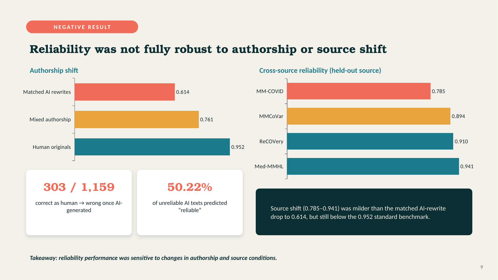
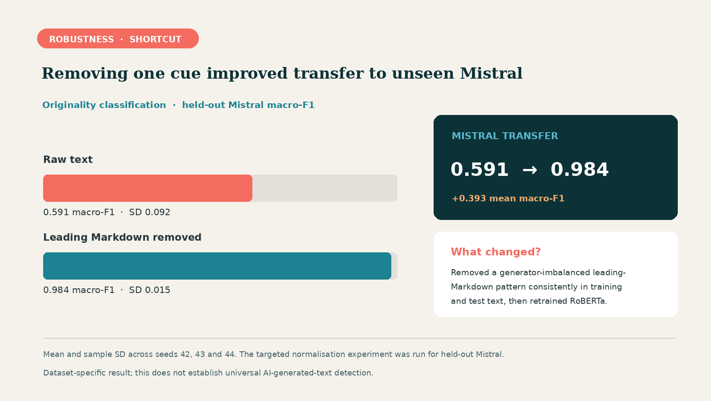
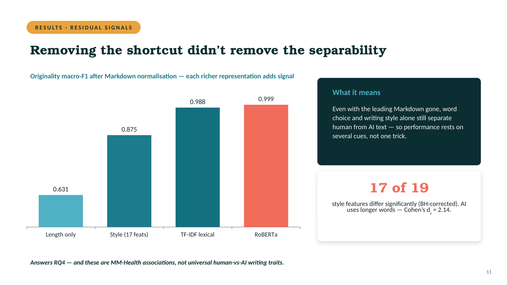

# Health Information NLP: Performance, Robustness and Shortcut Learning

**MSc Data Science and Artificial Intelligence dissertation | Queen Mary University of London**  
**Author:** Adelind Huan Ern Sho

[Dissertation (PDF)](reports/Dissertation_Public.pdf) · [Executed Jupyter notebook](notebooks/PG_Project_Full_Pipeline_AdelindSho.ipynb) · [MM-Health dataset](https://huggingface.co/datasets/zzha6204/MM-Health)

## Project overview

High classification scores on a familiar test set do not necessarily mean that a model has learned a reliable decision rule. This project investigates how well NLP classifiers generalise when health-information text changes in authorship, source or AI generator, and whether models exploit dataset-specific shortcuts.

Using the text component of **MM-Health**, I evaluated two dataset-defined tasks:

- **Reliability classification:** reliable versus unreliable *human-written* health articles, using labels inherited from the source datasets.
- **Originality classification:** human-written versus AI-generated articles, using the generators represented in MM-Health.

I compared classical machine-learning baselines with BERT, RoBERTa and PubMedBERT, then examined distribution shift, paired classification errors, leading-Markdown formatting and residual stylistic and lexical cues.

**Scope:** These labels do not provide independent medical fact-checking, and the originality task does not establish a universal AI-text detector.

## Results

### 1. Standard benchmark: RoBERTa performed best

| Model | Reliability macro-F1 | Originality macro-F1 |
| --- | ---: | ---: |
| TF-IDF + Logistic Regression | 0.854 | 0.988 |
| TF-IDF + Linear SVM | 0.901 | 0.996 |
| BERT | 0.918 | 0.993 |
| PubMedBERT | 0.920 | 0.998 |
| **RoBERTa** | **0.952** | **1.000** |

RoBERTa achieved the highest macro-F1 on both official test tasks and made significantly fewer errors than each alternative in paired McNemar comparisons with Holm correction (all adjusted *p* < 0.05). The originality score of **1.000 is rounded to three decimal places**.

These strong benchmark results motivated a closer examination of robustness rather than an assumption that performance would transfer to new conditions.

### 2. Reliability under authorship and source shift



The RoBERTa reliability model, trained on human-written articles, scored **0.952 macro-F1** on human originals but **0.614** when applied *without retraining* to one matched AI-generated version of each test article. Of **1,159** matched articles, **303** changed from a correct prediction in human form to an incorrect prediction in AI-generated form. Among the **227** unreliable-labelled AI-generated articles, **114 (50.22%)** were predicted as reliable.

Separately, leave-one-source-out evaluation produced macro-F1 scores between **0.785 and 0.941**. The matched authorship and held-out source experiments test different shifts; the latter also changes properties such as topic coverage, class prevalence and labelling practices.

### 3. An opening-format shortcut affected unseen-generator transfer



In leave-one-generator-out originality evaluation, RoBERTa transferred strongly to four of the five held-out generators. **Mistral** was the exception, with **0.591 ± 0.092** macro-F1 (mean ± sample standard deviation across seeds 42–44).

A leading-Markdown heading or bold-title pattern was common in text from the other generators but nearly absent in Mistral. After removing that opening cue consistently from the relevant training, validation and test texts and retraining, mean held-out Mistral macro-F1 increased to **0.984 ± 0.015**. The standard-split originality score remained near ceiling (**1.000 to 0.999**).

This was a **targeted Mistral follow-up**, not a normalisation experiment performed for all five held-out generators. The intervention supports the role of this formatting cue but does not establish that it was the only shortcut.

### 4. Structural and lexical signals remained after normalisation



| Representation | Features used | Macro-F1 |
| --- | --- | ---: |
| Length only | Article word count | 0.631 |
| Style only | 17 stylometric features | 0.875 |
| TF-IDF lexical | Words and bigrams | 0.988 |
| RoBERTa | First 256 contextual tokens | 0.999 |

These are **separately trained models using different representations**, not a single model built by incrementally adding features. Paired stylometric tests also found significant differences for **17 of 19** examined features after Benjamini–Hochberg correction.

The results show substantial dataset-specific separability after removing one formatting cue; they do not reveal which features RoBERTa uses internally or establish universal differences between human and AI-written text.

*Figures: the reliability and residual-signal images come from the MSc viva presentation (slides 9 and 11). The Mistral figure summarises the dissertation's targeted three-seed normalisation experiment in the same presentation style.*

## Data, methods and evaluation

- **Dataset:** MM-Health text data, consisting of **5,776** human-written health articles and five AI-generated versions per article (**34,656** text variants). The dataset is obtained from the official Hugging Face source; it is **not redistributed** in this repository.
- **Splitting:** Official article-grouped train/validation/test partitions; variants of the same source article remain in the same partition to prevent article-level leakage.
- **Models:** TF-IDF logistic regression, linear SVM, BERT, RoBERTa and PubMedBERT. The transformer experiments used class-weighted loss.
- **Robustness experiments:** Matched AI-generated versions, mixed-authorship evaluation, leave-one-source-out reliability, leave-one-generator-out originality and targeted leading-Markdown normalisation.
- **Additional analyses:** Paired error analysis, word-length baseline, stylometric analysis, style-only classification and normalised lexical TF-IDF classification.
- **Statistics:** Macro-F1 as the primary metric, paired McNemar testing with Holm correction, Wilcoxon signed-rank testing with Benjamini–Hochberg correction and paired Cohen's *d*<sub>z</sub> effect sizes.

The [dissertation PDF](reports/Dissertation_Public.pdf) provides the full experimental definitions, results and discussion.

## Explore and reproduce the notebook

### Option A: Read the completed analysis

Open the [executed notebook](notebooks/PG_Project_Full_Pipeline_AdelindSho.ipynb) on GitHub to inspect its saved code, outputs, tables and figures. **No GPU, checkpoint download or Google Drive access is needed simply to read the saved results.**

### Option B: Run the pipeline

1. Open `notebooks/PG_Project_Full_Pipeline_AdelindSho.ipynb` in **Google Colab** (recommended, with a GPU runtime) or a compatible local Jupyter environment.
2. Install the dependencies. For local Jupyter, run `pip install -r requirements.txt` from the repository root. In Colab, the notebook includes a package-installation cell. The requirements list is **not a pinned, independently tested environment lockfile**.
3. Run the notebook cells in order. The data-loading code downloads the official `train_test_splited_data.json` file from [`zzha6204/MM-Health`](https://huggingface.co/datasets/zzha6204/MM-Health) using the Hugging Face Hub. An internet connection is required for initial downloads.
4. The setup cell creates an `mmhealth_models` directory if needed. For standard transformer experiments, `RETRAIN_IF_EXISTS = False` means that **compatible saved checkpoints are loaded when present, and missing models are trained using the existing pipeline**. Keep `SAVE_MODELS = True` for the full pipeline because later authorship-shift evaluation reloads the standard reliability RoBERTa model.
5. The leave-one-source-out and leave-one-generator-out robustness experiments **train fresh RoBERTa models** for their held-out conditions. They remain computationally expensive even if the standard model checkpoints already exist.

### Google Drive and saved model checkpoints

**The previous download link for the author's saved model weights has been removed.** Checkpoints are **not included in this GitHub repository**, and no access to the author's Google Drive is needed.

The modified notebook still uses the following locations by default:

| Where the notebook runs | Checkpoint directory |
| --- | --- |
| **Google Colab** | `/content/drive/MyDrive/mmhealth_models` in **the person running the notebook's own Google Drive**; Colab asks them to authorise the mount |
| **Local Jupyter** | `./mmhealth_models` under the current working directory |

If that directory is empty, the notebook can train standard models and save their checkpoints there. Anyone who already has compatible saved checkpoints can place them in the expected model subdirectories for reuse. To save models somewhere else, change `OUTPUT_DIR` in the configuration cell.

**Reproducibility status:** The notebook contains the original executed dissertation outputs. The public-facing update changed only the checkpoint-folder setup and its instructions; the complete GPU pipeline **has not been rerun independently** after that change. Retraining may produce slightly different values depending on package versions, hardware and random seeds.

The standard transformer configuration was **3 epochs**, **batch size 16**, **learning rate 2 × 10⁻⁵**, **weight decay 0.01**, **maximum sequence length 256** and **seed 42**, except where reported otherwise. Held-out Mistral experiments used seeds **42, 43 and 44**.

## Repository structure

```text
health-information-robustness-nlp/
├── README.md
├── requirements.txt
├── .gitignore
├── notebooks/
│   └── PG_Project_Full_Pipeline_AdelindSho.ipynb
├── reports/
│   └── Dissertation_Public.pdf
└── figures/
    ├── reliability_authorship_source_shift.png
    ├── mistral_markdown_robustness.png
    └── originality_residual_signals.png
```

The single README is at the repository root. `requirements.txt` lists Python dependencies, while `.gitignore` prevents selected local files, credentials and large model outputs from being accidentally committed. Other optional materials, if uploaded, are not shown in this overview.

## Limitations

- MM-Health reliability labels are inherited from the original component datasets and are **not independently verified medical truth labels**.
- AI versions were generated from topic summaries rather than direct paraphrases. Changes in wording, attribution or information content may contribute to the matched authorship-shift findings; effects cannot be attributed solely to style.
- Leaving out a source dataset changes multiple factors at once, including topic mix, source composition and potentially labelling practices.
- Transformer inputs are limited to the **first 256 tokens**, potentially overemphasising article openings.
- Most held-out training conditions used a single seed; the anomalous Mistral condition was examined with three seeds.
- The stylistic and lexical associations are specific to MM-Health, not evidence of universal AI-writing traits or of RoBERTa's internal decision process.

This is an **assessed MSc dissertation project**, not a peer-reviewed publication or a clinically validated medical fact-checking system.

## Dataset reference

Zhang, Z. et al. (2025). *From Generation to Detection: A Multimodal Multi-Task Dataset for Benchmarking Health Misinformation*. Findings of EMNLP 2025. [Paper](https://doi.org/10.18653/v1/2025.findings-emnlp.1316) · [Dataset](https://huggingface.co/datasets/zzha6204/MM-Health)
